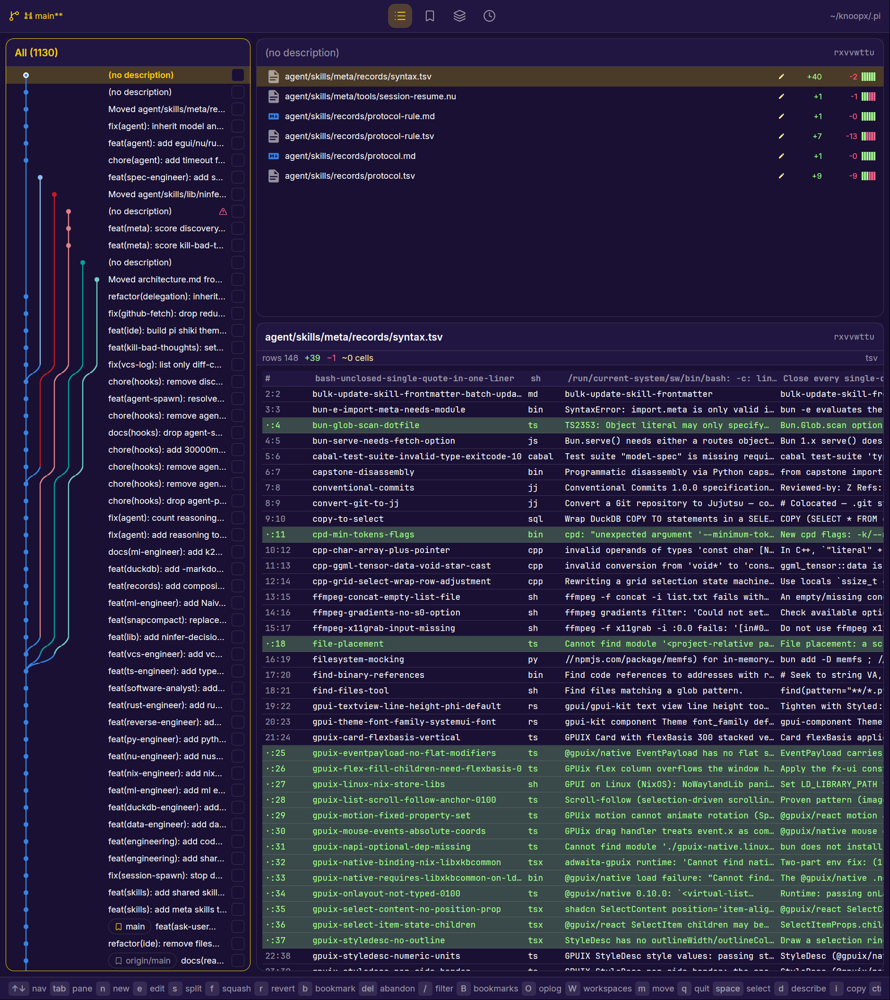
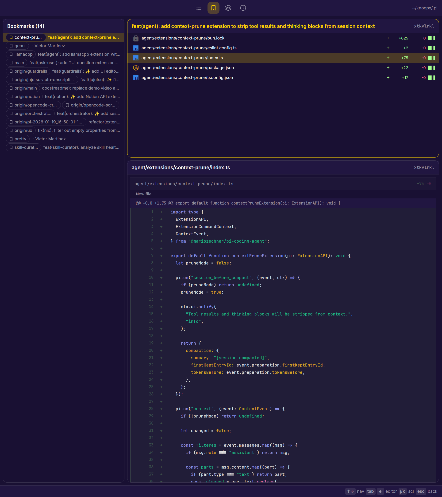
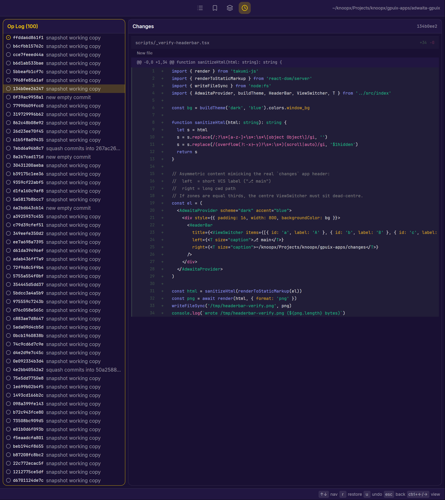
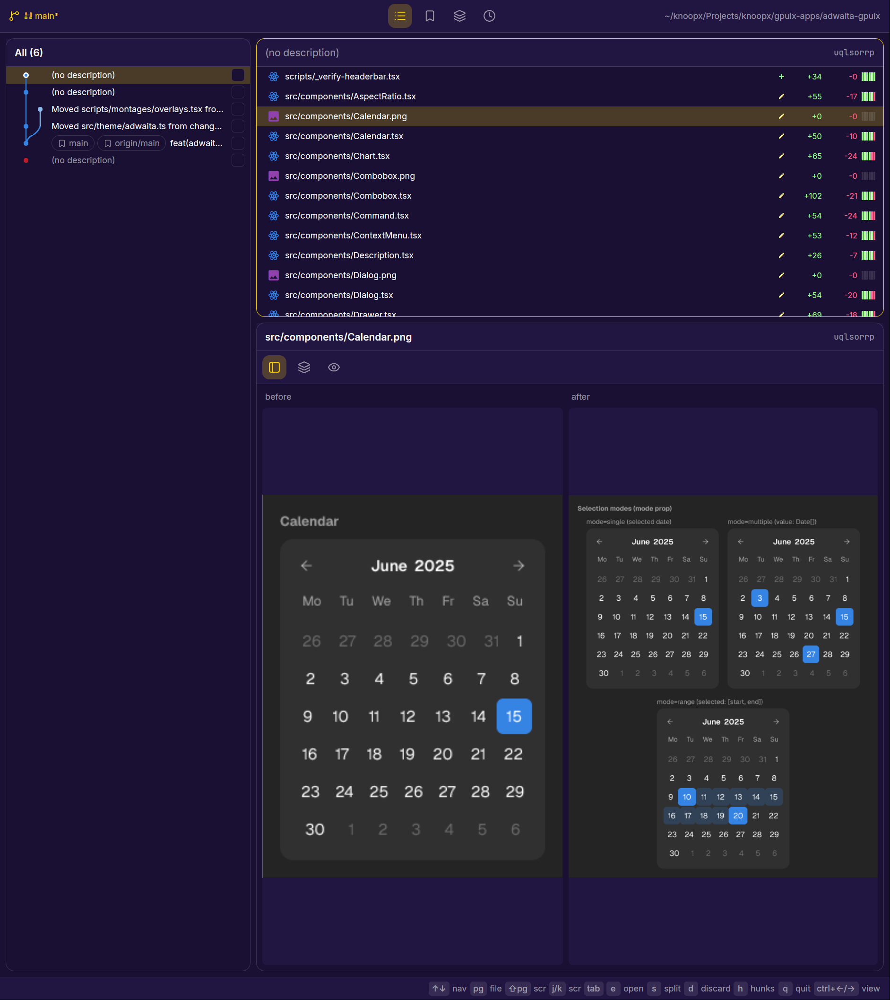

# Changes

A native, GPU-rendered desktop app for [Jujutsu](https://github.com/martinvonz/jj)
(`jj`) — no Electron, no webview: the UI is rendered directly by a GPU
renderer.

## What it does

Browse and manipulate a jj repository from a single window:

- **Changes** — the main view. A change list with a commit-graph gutter
  (branching history drawn per row), bookmark pills, and conflict markers,
  beside the change's file list and a diff preview. Text diffs get
  word-level highlighting, tabular files (csv/tsv) render as a table, and
  image files get a before/after comparison. Create, edit, split, squash,
  revert, and abandon changes; reorder them in move mode; multi-select and
  describe in one go; set or create bookmarks from a typeahead overlay; copy
  the change id; push a change's bookmarks; open a file in your editor. A
  revision filter is cycled in place; the filter set and the starting filter
  are user-configurable (see [Configuration](#configuration)).

  
  *Changes view: commit-graph gutter + file list + table diff preview.*

- **Bookmarks** — bookmark groups (local + remote references) with a file
  list and diff preview for each group's change; fetch, push, or forget
  bookmarks, and start a new change from a group.

  
  *Bookmarks view: bookmark groups + file list + unified-diff preview.*

- **Op log** — the last 100 operations, each previewing the changes it
  introduced as a diff; restore to any operation, or undo the latest one.

  
  *Op-log view: operation history + diff of the operation's changes.*

- **Hunks** — a detail view of a file's hunks: select hunks, then split them
  into a new change or discard them (requires `jj-hunk`).

  
  *Hunks view: image-file diff across a component-library change.*

- **Workspaces** — a browser for jj workspaces with per-workspace file list
  and diff; create a workspace, attach to its session, rebase + describe,
  open it in an editor or terminal, discard files, and delete it.

Lists refresh automatically when the repository changes on disk, and
transient results surface as toasts. The header bar carries the view
switcher, the current branch label, and the working directory; the status bar
shows the active view's key hints.

## Requirements

- [Bun](https://bun.sh)
- `jj` on your `PATH`
- `jj-hunk` on your `PATH` (optional — only needed for the Hunks view)
- `tmux` (or `wezterm`) on your `PATH` (only needed for the Workspaces
  attach / terminal actions)

## Run

```sh
bun install
bun --hot src/main.tsx [path]
```

or the standalone binary:

```sh
dist/changes [path]
```

An optional `[path]` opens the app at that directory's jj workspace root
(the nearest ancestor directory containing a `.jj`); when omitted it uses
the current working directory.

## Configuration

The revision filters shown in the Changes view (and which one starts
active) are configurable via `~/.config/changes/config.json`
(override the location with `$GPUIX_CHANGES_CONFIG`). The file is optional;
missing, empty, or invalid entries fall back to the built-in defaults.
Copy `examples/config.json` to get started.

```jsonc
{
  // Replace the built-in filter list. Each entry is a label + jj revset.
  "filters": [
    { "label": "Stack", "revset": "ancestors(@) ~ root()" },
    { "label": "All", "revset": "::" },
    { "label": "Mine", "revset": "mine()" },
    { "label": "Tracked", "revset": "bookmarks()" },
    { "label": "Recent", "revset": "committer_date(after:'30 days ago')" }
  ],
  // Label of the filter active when the view opens (default: "Stack").
  "defaultFilter": "Stack"
}
```

Only the keys you provide are applied: omit `filters` to keep the built-in
list, omit `defaultFilter` to start on Stack. Any revset jj accepts works
(`@`, `bookmark(main)`, `description(my ~)`, ...).
